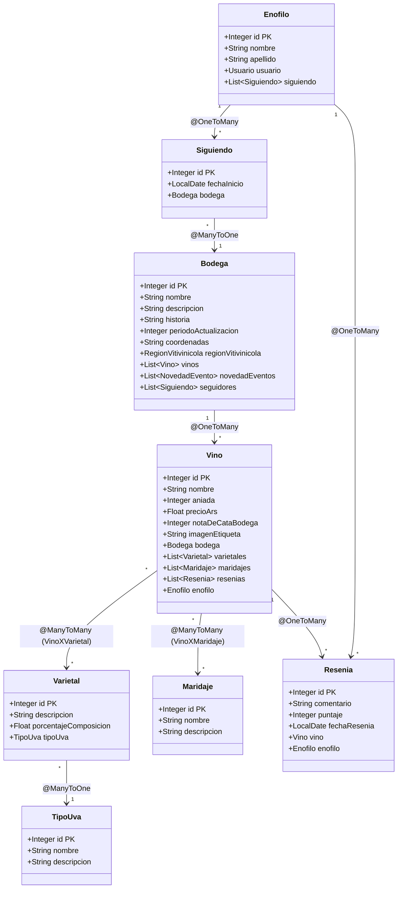

# 🍷 BonvinoPPAI - Prueba Técnica de Persistencia con JPA

* **Materia:** Diseño de Sistemas de Información (DSI)
* **Año Lectivo:** 2024
* **Carrera:** Ingeniería en Sistemas de Información
* **Institución:** Universidad Tecnológica Nacional - Facultad Regional Córdoba (UTN-FRC)

---

## 🛠 Stack Tecnológico y Herramientas

* **Lenguaje:** [Java 21](https://www.oracle.com/java/)
* **Framework Backend:** [Spring Boot 3.3.5](https://spring.io/projects/spring-boot)
* **Persistencia y ORM:** [Spring Data JPA](https://spring.io/projects/spring-data-jpa) con [Hibernate](https://hibernate.org/)
* **Base de Datos:** Microsoft SQL Server
* **Modelado UML:** [StarUML](https://staruml.io/) (Diagramas de Clases de Análisis y Secuencias en `documentacion/ClasesAnalisis.mdj`)
* **Reducción de Boilerplate:** [Project Lombok](https://projectlombok.org/)

---

## 📋 Naturaleza y Propósito del Repositorio

Este proyecto fue desarrollado como una **prueba técnica y laboratorio experimental de persistencia con Spring Data JPA y Hibernate** sobre el dominio vitivinícola de la plataforma **Bonvino** (cátedra DSI 2024).

Su objetivo principal fue dominar el mapeo objeto-relacional (ORM) de grafos de entidades complejos y relaciones bidireccionales en Java moderno, **sirviendo como desarrollo previo y base técnica formativa que precedió al Trabajo Práctico de la Red Sísmica (TPAI 2025)**.

> **Nota de Contexto Académico:**  
> La entrega formal evaluada en la cátedra DSI 2024 se implementó mediante Programación Orientada a Objetos pura en memoria con interfaz Java Swing. Este repositorio representa la extensión y maduración tecnológica del equipo para validar la persistencia relacional en base de datos.

---

## 🎯 Objetivos de la Prueba Técnica

1. **Mapeo de Relaciones Complejas en JPA:**
   - Asociaciones `@ManyToMany` con tablas intermedias explícitas (`VinoXVarietal`, `VinoXMaridaje`, `BodegaXEvento`).
   - Relaciones jerárquicas `@ManyToOne` y `@OneToMany` con carga perezosa (*lazy loading*) y control de referencias circulares (`Bodega` $\leftrightarrow$ `Vino` $\leftrightarrow$ `Resenia`).
2. **Configuración de Conectividad con Base de Datos:**
   - Integración con motor Microsoft SQL Server mediante dialectos nativos de Hibernate (`SQLServerDialect`).
   - Generación y actualización automática del esquema DDL (`ddl-auto=update`) a partir de las entidades Java.
3. **Validación del Modelo de Análisis:**
   - Correspondencia directa entre las especificaciones formales de StarUML ([`documentacion/ClasesAnalisis.mdj`](./documentacion/ClasesAnalisis.mdj)) y el modelo de persistencia anotado.

---

## 🏛 Modelo de Entidades Mapeadas (JPA / Hibernate)

Estructura de entidades implementadas en [`bonvino/bonvino/src/main/java/com/utn/frc/dsi/bonvino/entities/`](./bonvino/bonvino/src/main/java/com/utn/frc/dsi/bonvino/entities/):

---

## 📌 Documentación y Modelado Incluido

El repositorio conserva el modelo formal de la cátedra en la carpeta [`documentacion/`](./documentacion):
- **`ClasesAnalisis.mdj`:** Archivo de proyecto StarUML que documenta:
  - Diagrama de Clases de Análisis completo del dominio vitivinícola.
  - Diagrama de Secuencia del **CU5: "Importar Actualización de Vinos de Bodega"** (interacción entre el operador, el controlador de frontera, el sistema externo de la bodega y el despacho de notificaciones a los enófilos seguidores).

---

*Cátedra de Diseño de Sistemas de Información (DSI) — Ciclo Lectivo 2024 — Universidad Tecnológica Nacional, Facultad Regional Córdoba (UTN-FRC).*